# Financial Analytics System

## Walkthrough

The screens below trace a single CSV upload from sign-in, through validation and the analysis
pipeline, to the refreshed Power BI dashboard.

### Web application

**1. Sign in** — Finance officers, administrators and department heads authenticate here; the role
attached to the account decides which page they land on and which departments' data they can see.

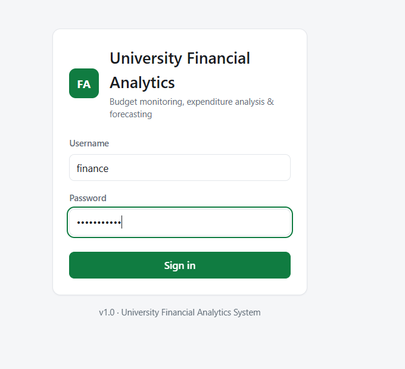

**2. Data management workspace** — The finance officer's landing page, showing the three-stage
workflow and a drop zone that accepts a departmental expenditure CSV of up to 20 MB.

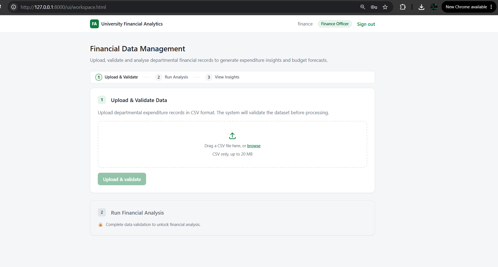

**3. File preview and column check** — The selected file is read in the browser to report its record,
column and department counts, preview the first five rows, and confirm all 18 required columns are
present before anything is sent to the server.

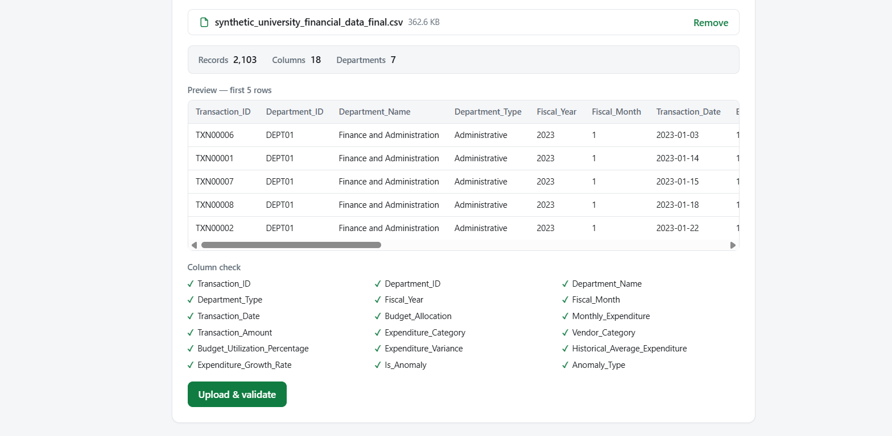

**4. Validation results** — The server reports how many rows were inserted, how many already existed
and how many were rejected by the validation rules. A successful ingest unlocks the analysis step.

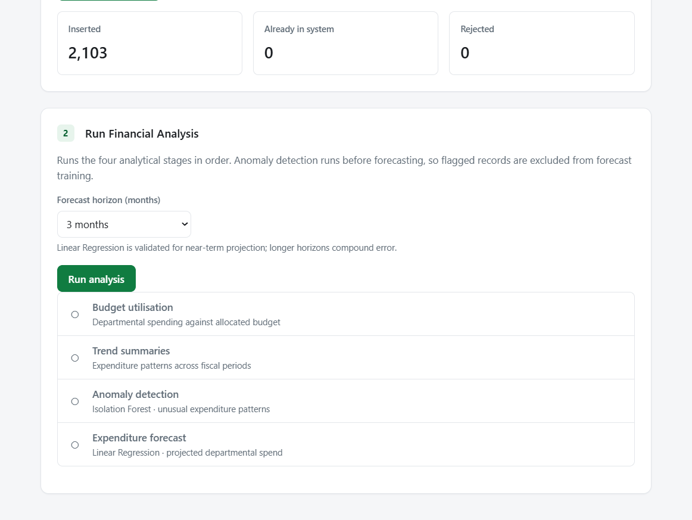

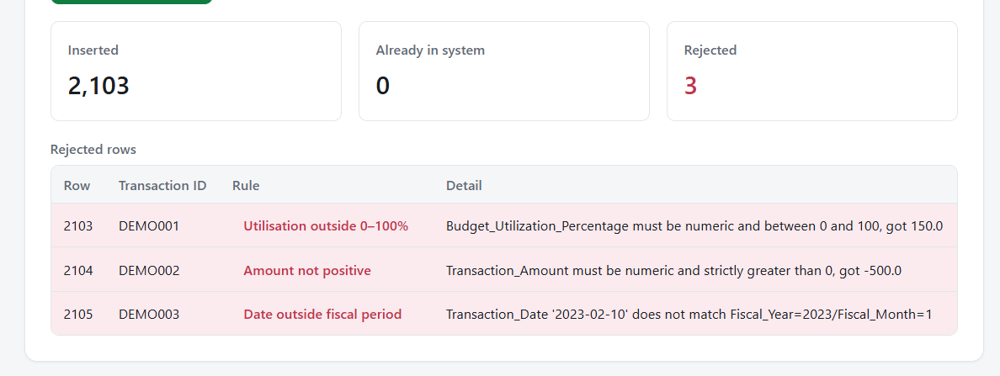

**5. Analysis complete** — The four stages run in order and the run is summarised: transactions
analysed, anomalies flagged, forecasts generated and elapsed time, with the audit log of every
action the pipeline performed.

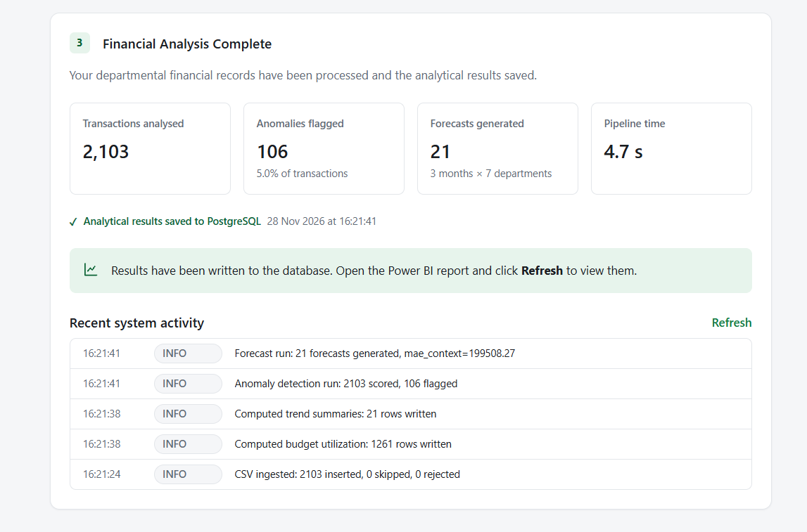

### Power BI dashboard

Power BI reads the finished results straight from the PostgreSQL views, so refreshing the report
after a run shows the new figures without the API being involved.

<details>
<summary><b>Five dashboard pages</b> (click to expand)</summary>

**Executive Summary** — Headline budget, expenditure, utilisation and model-accuracy figures, with
spend over time and a per-department comparison of expenditure against budget.

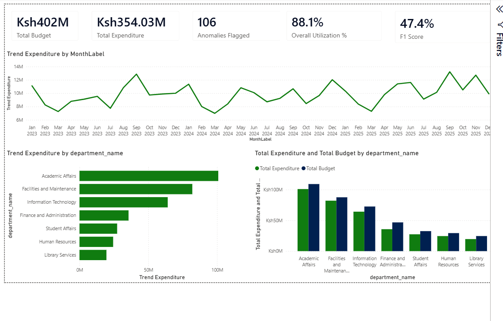

**Budget Overview** — Monthly utilisation per department as a colour-graded matrix that highlights
where spending has exceeded its allocation, alongside spend by category and year-to-date expenditure
tracked against budget.

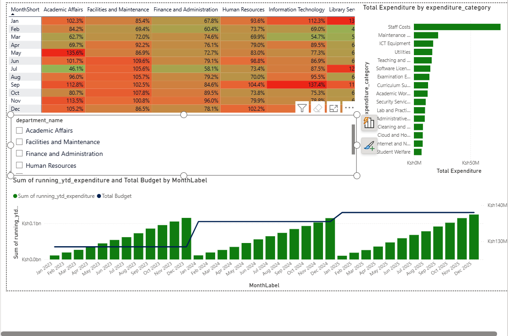

**Expenditure Trends** — How each department's monthly spend moves over the full period, with the
average growth rate and a breakdown of where the money goes by vendor type.

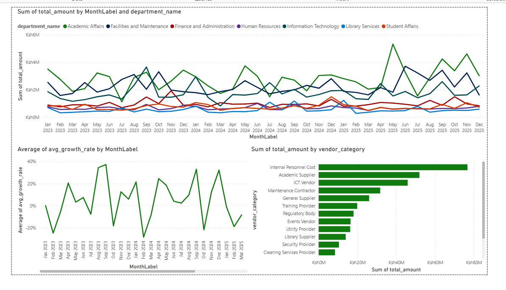

**Anomaly Detection** — How the Isolation Forest performed against the labelled anomalies, broken
down by anomaly type, with every flagged transaction listed and its score.

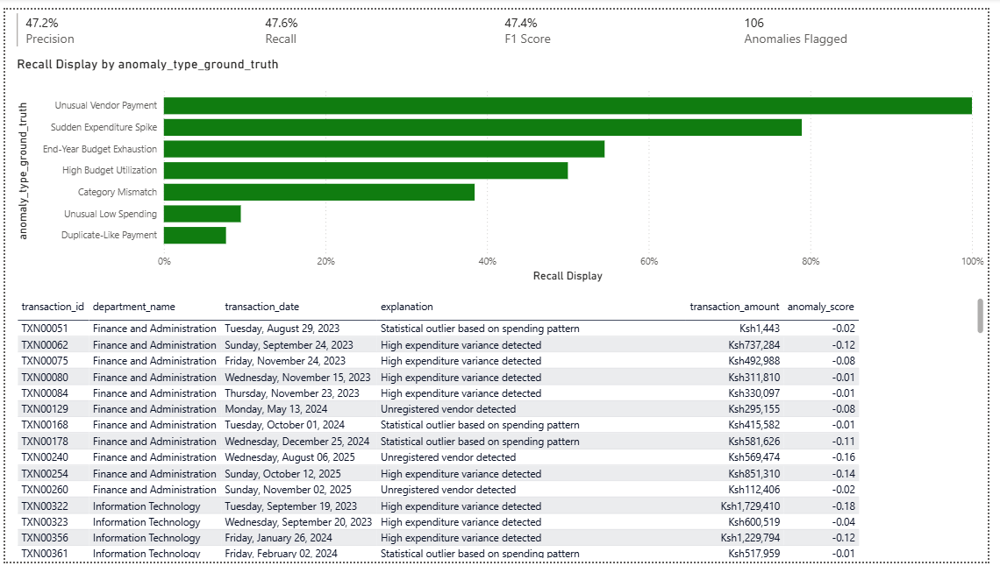

**Forecasting** — The Linear Regression projection continuing on from actual expenditure, the
forecast split by department, and the training error for the model behind it.

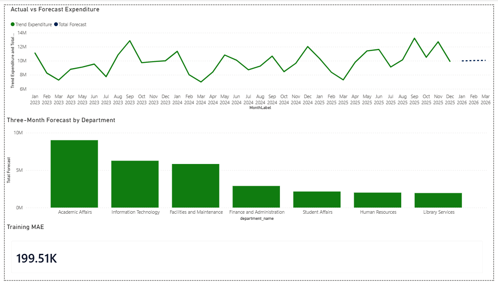

</details>

## 1. Project Overview

The Financial Analytics System is a budget monitoring, expenditure analytics, anomaly detection,
and expenditure forecasting platform built for resource-constrained universities. It ingests
university expenditure data from CSV files, stores it in PostgreSQL, and exposes it through a
role-scoped REST API so that finance officers, administrators, and department heads can track
spending against budget, spot unusual transactions, and forecast future expenditure.

Under the hood, an Isolation Forest model flags anomalous transactions and a Linear Regression
model forecasts monthly departmental expenditure, both retrained on every run so results always
reflect the latest data. A set of PostgreSQL views expose pre-aggregated analytics, anomaly, and
forecast data directly to Power BI, so reporting never depends on the API being online.

## 2. Tech Stack

| Component        | Technology                            |
| ---------------- | ------------------------------------- |
| Language         | Python 3.14                           |
| Web framework    | FastAPI                               |
| Database         | PostgreSQL                            |
| ORM / migrations | SQLAlchemy 2.x (synchronous), Alembic |
| Config           | pydantic-settings                     |
| Auth             | python-jose (JWT), passlib (bcrypt)   |
| Data processing  | pandas                                |
| Machine learning | scikit-learn, joblib                  |
| Testing          | pytest, httpx (TestClient)            |
| ASGI server      | uvicorn                               |
| BI / reporting   | Power BI (via PostgreSQL views)       |

## 3. Prerequisites

- Python 3.14+
- PostgreSQL 14+

## 4. Setup

```bash
git clone <repository-url>
cd financial_analytics

python -m venv .venv
# Windows
.venv\Scripts\activate
# macOS/Linux
source .venv/bin/activate

pip install -r requirements.txt

cp .env.example .env
# then edit .env and fill in at least:
#   DATABASE_URL     - your PostgreSQL connection string
#   SECRET_KEY       - a long random string for JWT signing
```

## 5. Database

```bash
createdb financial_analytics
alembic upgrade head
```

This applies all 5 migrations: the schema (with the `uuid-ossp` extension) and the
8 Power BI reporting views described in section 12.

## 6. Seed Data

Place the source CSV in `data/` (excluded from version control), then run:

```bash
python scripts/seed_data.py --csv data/synthetic_university_financial_data_final.csv
```

This requires the API server to already be running (see section 7) - the script ingests the CSV
through `POST /ingest/csv`. It seeds the 3 roles, a bootstrap `admin` user, the 3 standard
local-dev users (`admin` / `finance` / `depthead`, see the script for passwords - **local
development only, change in production**), ingests the CSV, and computes budget utilization and
trend summaries. The script is idempotent: running it again against the same CSV reports
`inserted_rows: 0` and leaves the rest of the database state unchanged.

## 7. Run the Server

```bash
uvicorn app.main:app --reload
```

Interactive API docs (Swagger UI) are available at [http://localhost:8000/docs](http://localhost:8000/docs).

## 8. Run Tests

```bash
pytest tests/ -v
```

Most integration tests run against an in-memory-equivalent SQLite database and need no setup.
Tests that exercise the PostgreSQL-only reporting views (variance/YTD/anomaly/forecast views)
are verified separately against a live `TEST_DATABASE_URL` database, not through this command.

## 9. Run Model Evaluation

```bash
python -m scripts.evaluate_models --model both
```

`--model` accepts `if` (Isolation Forest precision/recall/F1), `lr` (Linear Regression MAE/RMSE),
or `both` (default). Run this after `POST /anomaly/detect` and `POST /forecasts/run` have
populated `anomaly_results` and there is expenditure data to hold out for the LR evaluation.

## 10. Data Dictionary

The source CSV has 18 columns:

| Column                           | Type             | Description                                                                                         |
| -------------------------------- | ---------------- | --------------------------------------------------------------------------------------------------- |
| `Transaction_ID`                 | string           | Unique transaction identifier                                                                       |
| `Department_ID`                  | string           | Department code                                                                                     |
| `Department_Name`                | string           | Human-readable department name                                                                      |
| `Department_Type`                | string           | Department category (e.g. Administrative, Academic)                                                 |
| `Fiscal_Year`                    | integer          | Fiscal year of the transaction                                                                      |
| `Fiscal_Month`                   | integer          | Fiscal month, 1-12                                                                                  |
| `Transaction_Date`               | date             | Date the transaction occurred                                                                       |
| `Budget_Allocation`              | decimal          | Department's total budget for the fiscal year (stored in `budgets`, not `expenditure_transactions`) |
| `Monthly_Expenditure`            | decimal          | Department's total expenditure for that fiscal month                                                |
| `Transaction_Amount`             | decimal          | Amount of this individual transaction                                                               |
| `Expenditure_Category`           | string           | Spending category (e.g. Administrative Operations)                                                  |
| `Vendor_Category`                | string           | Vendor classification (e.g. General Supplier, Unregistered Vendor)                                  |
| `Budget_Utilization_Percentage`  | decimal          | Percent of budget utilized at the time of the transaction (0-100)                                   |
| `Expenditure_Variance`           | decimal          | Deviation from the historical average expenditure                                                   |
| `Historical_Average_Expenditure` | decimal          | Department's historical average monthly expenditure                                                 |
| `Expenditure_Growth_Rate`        | decimal          | Month-over-month expenditure growth rate                                                            |
| `Is_Anomaly`                     | integer (0 or 1) | Ground-truth anomaly flag; maps to `is_anomaly_ground_truth`                                        |
| `Anomaly_Type`                   | string           | Ground-truth anomaly category; maps to `anomaly_type_ground_truth`, `"Normal"` if not anomalous     |

## 11. API Endpoints

All endpoints except `/`, `/health`, and `/auth/token` require a `Bearer` JWT access token.
`any_authenticated` means any of `admin`, `finance_officer`, or `department_head`; `department_head`
users are additionally scoped to their own department's data on every GET listed below.

| Method | Path                                    | Role Required         | Description                                       |
| ------ | --------------------------------------- | --------------------- | ------------------------------------------------- |
| GET    | `/`                                     | none                  | API info                                          |
| GET    | `/health`                               | none                  | Database connectivity check                       |
| POST   | `/auth/token`                           | none                  | Login, obtain a JWT access token                  |
| GET    | `/auth/me`                              | any_authenticated     | Signed-in user identity, role and department      |
| POST   | `/users`                                | admin                 | Create a user                                     |
| GET    | `/users`                                | admin                 | List users                                        |
| POST   | `/ingest/csv`                           | finance_officer/admin | Bulk ingest a CSV of expenditure transactions     |
| POST   | `/departments`                          | admin                 | Create a department                               |
| POST   | `/departments/{department_id}/budgets`  | finance_officer/admin | Create a budget for a department/fiscal year      |
| GET    | `/departments`                          | any_authenticated     | List departments                                  |
| GET    | `/departments/{department_id}`          | any_authenticated     | Get a single department                           |
| GET    | `/budgets`                              | any_authenticated     | List budgets                                      |
| POST   | `/transactions`                         | finance_officer/admin | Create a transaction (manual entry)               |
| GET    | `/transactions`                         | any_authenticated     | List transactions, with filters                   |
| GET    | `/transactions/{transaction_id}`        | any_authenticated     | Get a single transaction                          |
| POST   | `/analytics/compute/budget-utilization` | finance_officer/admin | Recompute the budget utilization report           |
| GET    | `/analytics/budget-utilization`         | any_authenticated     | List budget utilization report rows               |
| GET    | `/analytics/variance-report`            | any_authenticated     | Expenditure variance statistics                   |
| GET    | `/analytics/growth-rate`                | any_authenticated     | Average expenditure growth rate                   |
| POST   | `/reporting/compute/trend-summaries`    | finance_officer/admin | Recompute annual trend summaries                  |
| GET    | `/reporting/trend-summaries`            | any_authenticated     | List trend summaries                              |
| POST   | `/anomaly/detect`                       | finance_officer/admin | Retrain the Isolation Forest and rescore all rows |
| GET    | `/anomaly/results`                      | any_authenticated     | List anomaly detection results                    |
| POST   | `/forecasts/run`                        | finance_officer/admin | Retrain the Linear Regression model and forecast  |
| GET    | `/forecasts`                            | any_authenticated     | List forecast results                             |
| GET    | `/logs`                                 | finance_officer/admin | List audit log entries, newest first              |

## 12. Power BI Connection Guide

Power BI connects directly to PostgreSQL - never to the FastAPI application and never to the
source CSV. In Power BI Desktop: **Get Data → PostgreSQL database**, then supply:

- **Server**: your PostgreSQL host (e.g. `localhost`)
- **Port**: `5432` (default)
- **Database**: `financial_analytics`
- **Username / password**: your PostgreSQL credentials with read access to the database

All 8 views below are created via Alembic migrations and are safe to connect to directly:

| View                         | Migration | Purpose                                                                         |
| ---------------------------- | --------- | ------------------------------------------------------------------------------- |
| `vw_budget_utilization`      | 0002      | Pre-computed utilization by department/month/category                           |
| `vw_expenditure_trends`      | 0002      | Expenditure totals and growth by department and month                           |
| `vw_vendor_category_summary` | 0002      | Spending and anomaly flags by vendor type                                       |
| `vw_ytd_budget_utilization`  | 0002      | Cumulative year-to-date expenditure vs. budget per department (window function) |
| `vw_anomaly_flagged`         | 0003      | All Isolation-Forest-flagged transactions with full context                     |
| `vw_anomaly_comparison`      | 0003      | Ground-truth anomaly labels vs. model predictions                               |
| `vw_forecast_vs_actuals`     | 0004      | Linear Regression forecasts compared to trend summary actuals                   |
| `vw_system_activity`         | 0005      | Application audit trail of pipeline actions and errors                          |

## 13. Web Interface

A plain HTML/CSS/JavaScript interface is served by the application itself from `app/static`.
It has no build step, no framework and makes no external requests.

### Start it

```bash
uvicorn app.main:app --reload
```

Then open [http://localhost:8000/ui/](http://localhost:8000/ui/).

### Demo users

Seeded by `scripts/seed_data.py` (see section 6). **Local development only.**

| Username   | Password       | Role              | Lands on        | Can do                                                                           |
| ---------- | -------------- | ----------------- | --------------- | -------------------------------------------------------------------------------- |
| `finance`  | `Finance@123`  | `finance_officer` | Workspace       | Upload a CSV, run the full analysis pipeline, see results and activity           |
| `admin`    | `Admin@123`    | `admin`           | Workspace       | The same as the finance officer, plus user and department management via the API |
| `depthead` | `DeptHead@123` | `department_head` | Department view | Read-only: flagged transactions and the forecast for their own department only   |

Role routing happens after sign-in: `admin` and `finance_officer` go to the workspace,
`department_head` goes to the department view. The restriction is enforced on the server, not in the
browser - a department head who requests the workspace page is redirected, and every API response is
filtered to their `department_id` regardless of what the client asks for.

### Demo procedure

1. **Reset** - `python -m scripts.reset_demo --yes` empties the transaction, analytics, forecast,
   anomaly and audit-log tables, keeping roles, users and departments.
2. **Refresh Power BI** - every page should render empty without errors. This is the "before" state.
3. **Upload** - sign in at `/ui/` as `finance`, drop `data/demo_upload.csv` on the upload panel,
   check the column report, then upload. Three rows are deliberately rejected - budget utilization
   above 100% (`RULE_1_UTILIZATION`), a negative amount (`RULE_2_AMOUNT`), and a transaction date whose
   month does not match its fiscal period (`RULE_5_DATE`) - and are listed with their reasons.
4. **Run analysis** - pick a forecast horizon and click **Run analysis**. The four pipeline steps run
   in order: budget utilization, trend summaries, anomaly detection (Isolation Forest), then
   expenditure forecasting (Linear Regression). Results and recent activity appear when it finishes.
5. **Refresh Power BI** - the same report pages now render the full analysis. This is the "after" state.

To verify the whole flow without clicking through it, run `python -m scripts.smoke_demo` against a
running server (see section 14).

### How the two interfaces fit together

The web app is the **operational interface**: data enters through it, is validated against the
expected CSV schema and the business rules, is written to PostgreSQL, and triggers the analytics and
ML pipeline through the API. Power BI is the **reporting interface**: it reads the finished results
straight from the PostgreSQL views listed in section 12 on each refresh, never from FastAPI and never
from a CSV. The two never talk to each other - PostgreSQL is the only thing they share. Every
pipeline action and error is written to the `system_logs` table by the application logger, so the
audit log in the workspace, the `GET /logs` endpoint and the `vw_system_activity` Power BI view are
three views of the same audit trail.

## 14. End-to-End Smoke Test

```bash
python -m scripts.reset_demo --yes
uvicorn app.main:app --reload          # in a second terminal
python -m scripts.smoke_demo           # --server-url to point elsewhere
```

`scripts/smoke_demo.py` drives a running server through the whole demo path with `httpx`: sign in as
the finance officer, ingest `data/demo_upload.csv` and confirm the three expected rejection rules,
run the four pipeline steps in order and check each response, read back `GET /logs` to confirm every
pipeline action was recorded, then sign in as the department head and confirm that every anomaly and
forecast row returned belongs to their own department. It prints a `PASS`/`FAIL` line per check and
exits non-zero if any check fails. It does not reset the database itself - run `reset_demo --yes`
first for a clean run.
